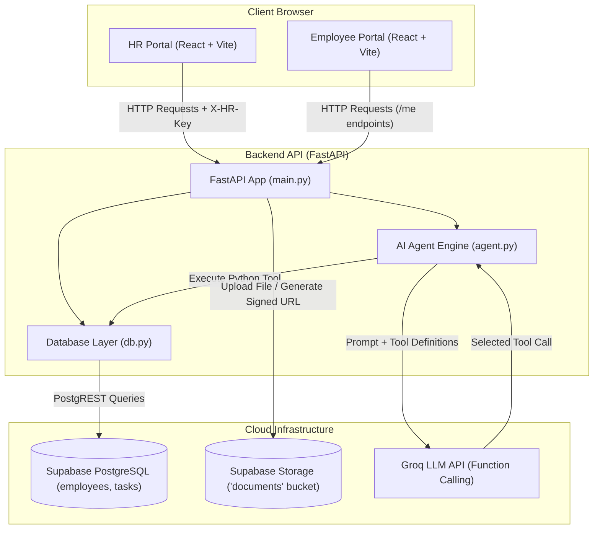

# OnboardHub

> A modern, streamlined employee onboarding and checklist tracking system powered by FastAPI, React, Supabase, and an AI-driven HR assistant.

---

## 1. Problem Statement

In many growing companies and organizations, employee onboarding is handled haphazardly across scattered email threads, physical paper forms, chat messages, and static spreadsheets. 

This manual approach introduces major operational friction:
* **Missed Documents:** Critical compliance files—such as government tax forms, NDAs, and signed offer letters—get lost in crowded inboxes.
* **Delayed IT & Workspace Setup:** Hardware provisioning, VPN setup, and corporate email account creation stall because IT teams lack timely visibility into start dates.
* **Confused New Hires:** Employees begin their first day unsure of which tasks remain pending, what documents require submission, or where to submit emergency contact details.
* **Lack of HR Visibility:** People operations teams cannot monitor real-time onboarding completion rates across departments without manually pinging new hires.

---

## 2. Solution Overview

**OnboardHub** provides a centralized, transparent web platform that structures the entire onboarding journey from offer acceptance to Day 1 readiness:

1. **Automated Checklist Assignment:** When HR registers a new hire with their department (General, Engineering, or Sales), a tailored set of onboarding tasks is created automatically in PostgreSQL.
2. **Dedicated Employee Portal:** New hires log in using their work email to see an intuitive progress ring, a spotlighted "Next Step" action card, a contact information form, and a numbered checklist with document upload buttons.
3. **Streamlined HR Operations:** HR administrators monitor real-time company-wide progress, filter employees by status, inspect uploaded documents through secure signed URLs, and approve or reject submissions with instant feedback notes.
4. **Intelligent AI Assistant:** An integrated LLM assistant powered by Groq connects directly to database tools, allowing HR to query statuses, inspect pending tasks, and draft personalized reminders using natural language.

---

## 3. Features

### HR Management Features
* **Live Overview Dashboard:** Metric cards tracking total team members, active checklists, completed hires, and pending tasks.
* **Real-time Search & Filter:** Instant search by employee name or email, plus status filters (*All*, *In Progress*, *Completed*).
* **Automated Task Provisioning:** Assigns core company-wide tasks plus specialized department checklists (e.g., NDA & GitHub/VPN setup for Engineering; Commission plan & CRM access for Sales).
* **Review & Verification Workflow:** Dedicated review modal to inspect uploaded PDFs or images, confirm approvals, or reject submissions with an actionable explanation note.
* **Secure Document Access:** Fetches time-limited signed URLs (10-minute expiration) directly from Supabase Storage so documents remain private.

### Employee Portal Features
* **Visual Progress Ring:** Circular progress indicator displaying real-time completion percentage (0% to 100%).
* **"Suggested Next Action" Spotlight:** Highlighted card pointing out the immediate next action (e.g., submitting personal details, uploading a missing document, or addressing a rejected submission).
* **Numbered Onboarding Checklist:** Clean step-by-step checklist with human-readable status badges (*Not started*, *Waiting for HR review*, *Approved*, *Needs fixing*).
* **Integrated Document Uploader:** Supports PDF, JPG, and PNG uploads directly to cloud storage with client-side and server-side file type and 5 MB size validation.
* **Collapsible Contact Information Form:** Accordion section for address, phone, and emergency contacts with a visible "Saved" indicator.
* **Completion Milestone:** Celebratory congratulations banner when reaching 100% completion.

### AI Agent Features
The built-in assistant uses function calling with live database execution. The agent has access to 5 real tools:
1. `register_employee`: Registers a new employee and provisions their department onboarding checklist.
2. `employee_status`: Retrieves completion percentage and outstanding tasks for a specific employee by email.
3. `list_employees`: Summarizes all registered employees with their completion status and pending items.
4. `add_task`: Appends an ad-hoc custom checklist task to an employee's onboarding list.
5. `review_task`: Approves or rejects an employee's task and attaches feedback notes.

---

## 4. Tech Stack

| Layer | Technology | Purpose |
| :--- | :--- | :--- |
| **Frontend** | React 19 + Vite | Fast, responsive single-page application built with plain CSS and modern components |
| **Backend** | Python 3.12 + FastAPI | High-performance asynchronous REST API with Pydantic validation |
| **Database** | Supabase (PostgreSQL) | Managed relational database storing employee profiles and checklist tasks |
| **Storage** | Supabase Storage | Encrypted cloud bucket for onboarding files (IDs, signed offer letters, NDAs) |
| **AI Engine** | Groq Cloud API | High-speed LLM inference running function calling for the HR assistant |
| **Deployment (Target)** | Render & Vercel | FastAPI backend deployed on Render; React frontend static build hosted on Vercel |

---

## 5. System Architecture



### How the AI Agent Loop Works
1. **User Message:** HR sends a natural language prompt (e.g., *"Show everyone's progress"* or *"Register Sarah Connor, sarah@test.com, Engineering, start 2026-11-01"*).
2. **Groq Model Processing:** The server sends the conversation history and system instructions alongside 5 JSON schema tool definitions to Groq.
3. **Tool Selection:** Groq determines which tool to execute and returns a structured `tool_calls` payload with extracted arguments.
4. **Execution in Python:** The backend matches the tool name to `db.py` functions and runs the query directly against Supabase.
5. **Feed Results Back:** The Python return value (JSON) is appended as a `tool` role message and sent back to Groq.
6. **Final Reply:** Groq synthesizes the tool result into a clear, concise natural language response displayed in the chat bubble.

---

## 6. Project Structure

```text
OnBoardHub/
├── README.md                     # Comprehensive project documentation and setup guide
├── .gitignore                    # Git exclusions for dependencies, environments, and secrets
├── backend/
│   ├── .env.example              # Template listing required environment variables (safe for git)
│   ├── main.py                   # FastAPI application routes, CORS middleware, and authentication guards
│   ├── db.py                     # Supabase client setup, automated checklists, and CRUD operations
│   ├── agent.py                  # Groq AI agent configuration, tool definitions, and tool-calling loop
│   └── requirements.txt          # Python dependencies (FastAPI, Uvicorn, Supabase, Groq, Pydantic)
└── frontend/
    ├── index.html                # HTML entry point with metadata and root mount target
    ├── vite.config.js            # Vite bundler configuration with React plugin
    ├── package.json              # Frontend dependencies (React 19, Vite) and build scripts
    ├── public/                   # Static browser assets (icons, SVGs)
    └── src/
        ├── main.jsx              # React DOM initialization and strict mode rendering
        ├── App.jsx               # Root view coordinator managing auth state and toast providers
        ├── api.js                # Centralized fetch client for backend REST communication
        ├── index.css             # Vanilla CSS design system (tokens, sidebar, responsive grid, modals)
        ├── context/
        │   └── ToastContext.jsx  # Floating toast notification manager (success / error alerts)
        └── components/
            ├── Landing.jsx       # Public landing screen with HR key and employee email login cards
            ├── HrArea.jsx        # HR layout with collapsible left sidebar and active view routing
            ├── Dashboard.jsx     # Team onboarding metrics, search bar, filters, and employee table
            ├── RegisterForm.jsx  # New employee form with real-time department checklist preview
            ├── EmployeeDetail.jsx# Employee checklist grouped by status with approval/rejection modal
            ├── Assistant.jsx     # Conversational AI assistant with prompt chips and typing indicators
            ├── EmployeeArea.jsx  # Employee portal with progress ring, next action card, and file uploader
            └── shared/
                ├── Icons.jsx     # Lightweight handcrafted SVG icons
                ├── Modal.jsx     # Accessible dialog component for confirm/reject notes
                ├── ProgressRing.jsx # Circular animated SVG progress ring
                ├── StatusBadge.jsx # Color-coded status indicator chips
                └── Spinner.jsx   # Inline button loading spinner
```

---

## 7. Database & Storage Setup

Open your **Supabase Dashboard**, navigate to the **SQL Editor**, and run the following script to create the tables:

```sql
-- 1. Create Employees Table
CREATE TABLE public.employees (
    id UUID PRIMARY KEY DEFAULT gen_random_uuid(),
    name TEXT NOT NULL,
    email TEXT UNIQUE NOT NULL,
    role TEXT NOT NULL,
    department TEXT NOT NULL,
    start_date DATE NOT NULL,
    manager TEXT DEFAULT '',
    phone TEXT DEFAULT '',
    address TEXT DEFAULT '',
    emergency_name TEXT DEFAULT '',
    emergency_phone TEXT DEFAULT '',
    created_at TIMESTAMP WITH TIME ZONE DEFAULT NOW()
);

-- 2. Create Tasks Table
CREATE TABLE public.tasks (
    id UUID PRIMARY KEY DEFAULT gen_random_uuid(),
    employee_id UUID NOT NULL REFERENCES public.employees(id) ON DELETE CASCADE,
    title TEXT NOT NULL,
    owner TEXT NOT NULL CHECK (owner IN ('employee', 'hr')),
    requires_document BOOLEAN DEFAULT FALSE,
    status TEXT NOT NULL DEFAULT 'pending' CHECK (status IN ('pending', 'submitted', 'approved', 'rejected', 'done')),
    review_note TEXT,
    document_path TEXT,
    created_at TIMESTAMP WITH TIME ZONE DEFAULT NOW()
);

-- Create helpful index for fast employee queries
CREATE INDEX idx_tasks_employee_id ON public.tasks(employee_id);
```

### Storage Bucket Configuration
1. In your Supabase Dashboard, click on **Storage** in the left navigation.
2. Click **New Bucket**.
3. Name the bucket exactly **`documents`**.
4. Set the bucket to **Private** (do not enable public access). The backend automatically generates secure, time-limited signed URLs (`create_signed_url`) when HR views an uploaded file.

---

## 8. Setup and Installation

Follow these step-by-step instructions to run the application locally on your computer.

### Prerequisites
* **Python 3.12+** installed on your system.
* **Node.js 18+** and **npm** installed.
* **Git** installed.

---

### Step 1: Clone the Repository
```bash
git clone https://github.com/Ziyaan07/OnboardHub.git
cd OnboardHub
```

---

### Step 2: Configure and Run the Backend

1. Navigate to the backend directory:
   ```bash
   cd backend
   ```

2. Create a virtual environment:
   ```bash
   python3 -m venv venv
   ```

3. Activate the virtual environment:
   * **macOS / Linux:**
     ```bash
     source venv/bin/activate
     ```
   * **Windows (Command Prompt):**
     ```cmd
     venv\Scripts\activate.bat
     ```
   * **Windows (PowerShell):**
     ```powershell
     venv\Scripts\Activate.ps1
     ```

4. Install backend dependencies:
   ```bash
   pip install -r requirements.txt
   ```

5. Set up your environment variables:
   ```bash
   cp .env.example .env
   ```
   Open `backend/.env` in your text editor and add your real credentials:
   ```env
   GROQ_API_KEY=gsk_your_groq_key
   SUPABASE_URL=https://your-project-id.supabase.co
   SUPABASE_KEY=your_service_role_key
   HR_KEY=your_chosen_hr_password
   ALLOWED_ORIGIN=http://localhost:5173,http://localhost:5174,http://127.0.0.1:5173
   ```
   *(Note: Ensure `SUPABASE_URL` has no trailing `/rest/v1` or trailing slashes).*

6. Start the FastAPI server with auto-reload:
   ```bash
   uvicorn main:app --reload
   ```
   * The API server will start on: **`http://localhost:8000`**
   * Interactive Swagger documentation is available at: **`http://localhost:8000/docs`**

---

### Step 3: Configure and Run the Frontend

1. Open a **new terminal tab or window** and navigate to the frontend directory:
   ```bash
   cd frontend
   ```

2. Install dependencies:
   ```bash
   npm install
   ```

3. *(Optional)* If your backend runs on a port other than `8000`, create a `.env` file in `frontend/`:
   ```env
   VITE_API_URL=http://localhost:8000
   ```

4. Start the frontend development server:
   ```bash
   npm run dev
   ```
   * The React application will start on: **`http://localhost:5173`**

---

## 9. Environment Variables Reference

| Variable | Scope | Description | Example |
| :--- | :--- | :--- | :--- |
| `GROQ_API_KEY` | Backend (`.env`) | API Key from Groq Cloud for LLM inference | `gsk_abc123...` |
| `SUPABASE_URL` | Backend (`.env`) | The root HTTPS URL for your Supabase project | `https://xxxx.supabase.co` |
| `SUPABASE_KEY` | Backend (`.env`) | Supabase `service_role` secret key for DB and storage operations | `eyJhbGciOi...` |
| `HR_KEY` | Backend (`.env`) | Secret password required in the `X-HR-Key` header to unlock HR routes | `secure_hr_secret_123` |
| `ALLOWED_ORIGIN`| Backend (`.env`) | Comma-separated list of allowed frontend origins for CORS | `http://localhost:5173` |
| `VITE_API_URL` | Frontend (`.env`)| Base HTTP URL of the running FastAPI server (defaults to port 8000) | `http://localhost:8000` |

---

## 10. How to Use

### Walkthrough for HR Administrators
1. Navigate to `http://localhost:5173` in your browser.
2. Under the **HR Portal** card, enter your `HR_KEY` password and click **Enter HR Area**.
3. **Register New Hires:** Click **Register Employee** on the sidebar or dashboard. Enter the employee's name, email, role, start date, and choose their department to automatically provision their checklist.
4. **Inspect Progress:** Use the Dashboard search bar or status tabs (*All*, *In Progress*, *Completed*) to view team completion rates.
5. **Review Submitted Tasks:** Click on any employee row to open their profile. Tasks with uploaded documents appear under **Needs Your Review**. Click **View Document** to verify the file, then click **Approve** or **Reject** (which prompts you to enter feedback for the new hire).
6. **Chat with AI:** Click **AI Assistant** in the sidebar to ask questions like *"Who has pending documents?"* or *"Draft a reminder for Alex"*.

### Walkthrough for New Employees
1. Navigate to `http://localhost:5173`.
2. Under the **Employee Portal** card, enter your registered company email address (e.g. `alex@example.com`) and click **Open My Checklist**.
3. **Check the Welcome Banner:** Review your completion progress ring and read the highlighted **Suggested Next Action** card.
4. **Complete Personal Information:** Expand the **Personal & Emergency Contact Details** accordion, fill in your address and emergency contact numbers, and click **Save Personal Information**.
5. **Upload Required Documents:** For tasks requiring documents (e.g., Government ID, Signed Offer Letter, NDA), click the **Upload File** button, select your PDF or image (max 5 MB), and submit.
6. **Track Status:** Your items update to **Waiting for HR review**. If an item is rejected, read HR's feedback note directly on the card and use the **Re-upload** button to submit a corrected version. Once all items reach 100%, a celebratory milestone banner confirms your onboarding is complete!

---

## 11. API Endpoints

All endpoints are hosted under `http://localhost:8000`.

| Method | Path | Authentication / Role | Description |
| :--- | :--- | :--- | :--- |
| `GET` | `/health` | Public | System health check returning `{"ok": true}` |
| `GET` | `/hr/employees` | HR (`X-HR-Key` Header) | Returns list of all registered employees with completion % and pending task names |
| `POST` | `/hr/employees` | HR (`X-HR-Key` Header) | Registers a new employee and assigns automatic department checklist |
| `GET` | `/hr/employee` | HR (`X-HR-Key` Header) | Returns profile, full task checklist, and 10-minute signed document URLs |
| `POST` | `/hr/review` | HR (`X-HR-Key` Header) | Approves or rejects a task submission with an optional or required review note |
| `POST` | `/hr/agent` | HR (`X-HR-Key` Header) | Executes the multi-turn Groq tool-calling agent loop on database queries |
| `GET` | `/me` | Employee (Query: `?email=`) | Returns employee profile and only the tasks owned by the employee |
| `PUT` | `/me/info` | Employee (Body JSON) | Updates contact information and marks "Complete personal information" as done |
| `POST` | `/me/upload` | Employee (Multipart Form) | Uploads PDF/JPG/PNG document to Supabase storage and marks task `submitted` |

---

## 12. Manual Testing Checklist

Run through this test sequence to verify the complete end-to-end functionality:

- [ ] **Health Check:** Open `http://localhost:8000/health` in browser and confirm `{"ok": true}`.
- [ ] **HR Authentication Guard:** Try accessing `http://localhost:8000/hr/employees` without header and verify `401 Unauthorized`.
- [ ] **HR Login:** Enter the configured `HR_KEY` in the frontend and confirm the sidebar dashboard loads.
- [ ] **Register Employee:** Register an employee with the `Engineering` department. Confirm that NDA and VPN/GitHub tasks are assigned.
- [ ] **Employee Portal Login:** Log out of HR and log in as the newly registered employee using their email.
- [ ] **Save Personal Info:** Fill in the phone, address, and emergency contact fields. Verify the green "Saved" badge appears.
- [ ] **Document Upload:** Upload a valid sample PDF (< 5 MB) for "Upload government ID". Verify the badge changes to "Waiting for HR review".
- [ ] **File Size / Type Rejection:** Attempt uploading an `.exe` or a file > 5 MB and confirm an error toast notification appears.
- [ ] **HR Rejection Flow:** Log back into HR, open the employee detail page, click **Reject** on the submitted document, and enter a rejection reason. Confirm the modal closes and task updates.
- [ ] **Employee Re-upload:** Return to the employee portal. Confirm the "Suggested Next Action" card highlights the rejected task and displays HR's feedback note.
- [ ] **HR Approval Flow:** Re-upload the document and approve it from the HR portal. Verify progress percentage updates.
- [ ] **AI Assistant Chat:** Navigate to the AI Assistant tab in HR and ask: *"Show everyone's progress"*. Verify it responds with a formatted markdown summary.

---

## 13. Deployment

### Backend Deployment (Render)
1. Push your repository to GitHub.
2. Sign in to [Render](https://render.com) and click **New +** -> **Web Service**.
3. Connect your GitHub repository.
4. Configure settings:
   * **Root Directory:** `backend`
   * **Runtime:** `Python 3`
   * **Build Command:** `pip install -r requirements.txt`
   * **Start Command:** `uvicorn main:app --host 0.0.0.0 --port $PORT`
5. Under **Environment Variables**, add:
   * `GROQ_API_KEY`
   * `SUPABASE_URL`
   * `SUPABASE_KEY`
   * `HR_KEY`
   * `ALLOWED_ORIGIN` (set this to your Vercel frontend URL once deployed)

### Frontend Deployment (Vercel)
1. Sign in to [Vercel](https://vercel.com) and click **Add New** -> **Project**.
2. Import your GitHub repository.
3. Configure settings:
   * **Root Directory:** Edit and select `frontend`.
   * **Framework Preset:** `Vite`.
   * **Build Command:** `npm run build`
   * **Output Directory:** `dist`
4. Under **Environment Variables**, add:
   * `VITE_API_URL` = `https://your-render-backend-url.onrender.com`
5. Click **Deploy**.
6. Once deployed, copy your production Vercel domain (e.g. `https://onboardhub.vercel.app`) and update the `ALLOWED_ORIGIN` variable in your Render backend settings so CORS requests succeed.

---

## 14. Security Notes

* **Server-side Secrets:** Sensitive keys (`GROQ_API_KEY` and `SUPABASE_KEY`) are stored strictly on the backend and are never exposed to the frontend bundle or client browser.
* **Header-based HR Protection:** Administrative endpoints (`/hr/*`) enforce strict authorization via the `X-HR-Key` header, blocking unauthorized access.
* **Short-lived Signed URLs:** Uploaded compliance documents are saved in a private storage bucket. Signed URLs expire after 10 minutes (`600 seconds`), preventing persistent unauthorized public file sharing.
* **File Validation:** The `/me/upload` endpoint validates both MIME types (`application/pdf`, `image/jpeg`, `image/png`) and file sizes (enforcing a strict 5 MB ceiling) to protect against buffer overflows or malicious payload uploads.
* **CORS Restrictions:** Cross-Origin Resource Sharing is locked down to explicit trusted frontend origins defined in `ALLOWED_ORIGIN`.

---

## 15. Known Limitations & Future Improvements

While OnboardHub provides a robust foundation, the following limitations are present in the current version:
1. **Simplified Employee Authentication:** New hires log in using only their registered email address without passwords.
   * *Future Improvement:* Integrate **Supabase Auth** (magic links or passwordless OTP) to provide cryptographically secure multi-factor user authentication.
2. **Single Shared HR Key:** All HR staff share a single `HR_KEY` environment variable.
   * *Future Improvement:* Implement Role-Based Access Control (RBAC) with individual HR user profiles, audit logs, and permission tiers.
3. **Manual Reminder Drafting:** The AI assistant can draft reminder messages, but HR must manually send them.
   * *Future Improvement:* Connect transactional email services (e.g., Resend or SendGrid) to automatically dispatch emails when tasks remain pending near the start date.
4. **Static Department Checklists:** Checklists are currently hardcoded in Python dictionaries inside `db.py`.
   * *Future Improvement:* Build an interactive Checklist Builder UI allowing HR managers to create and customize checklist templates dynamically from the web interface.

---

## 16. Author

* **Author:** `[Your Name Here]`
* **Course / Class:** `[Your Class / Course / Department Here]`
* **Project:** Final Onboarding Management System Capstone
* **Repository:** [GitHub - OnboardHub](https://github.com/Ziyaan07/OnboardHub.git)
